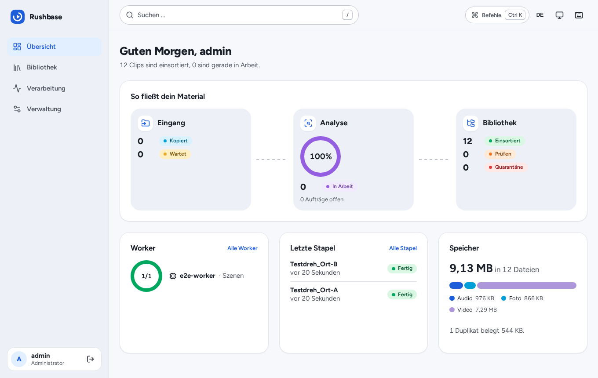
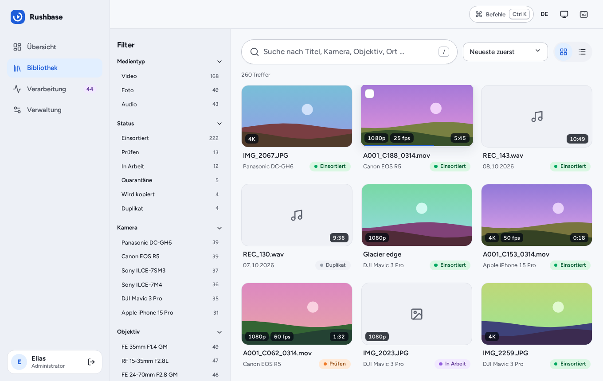
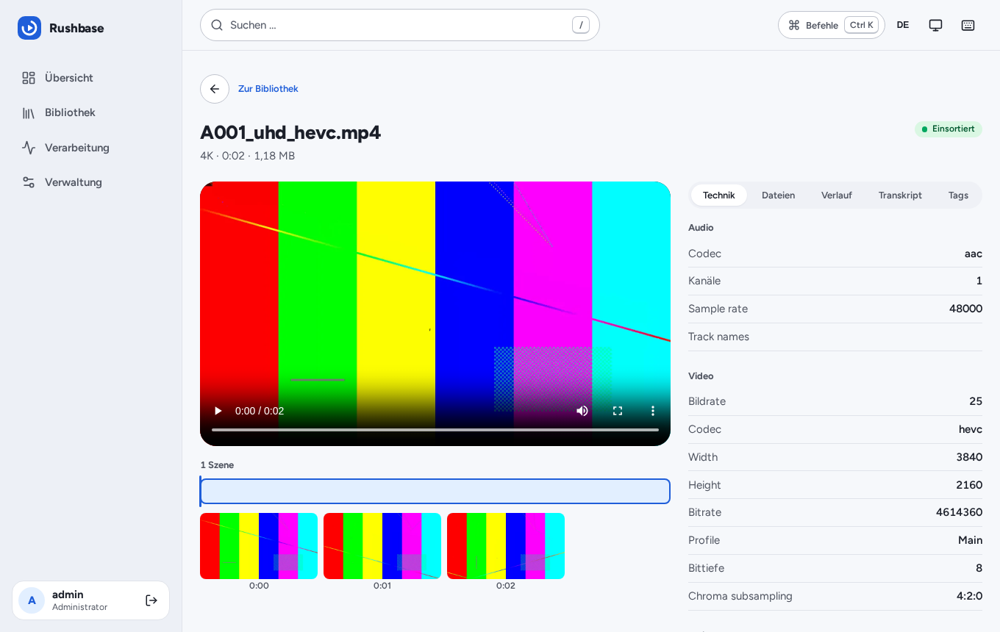
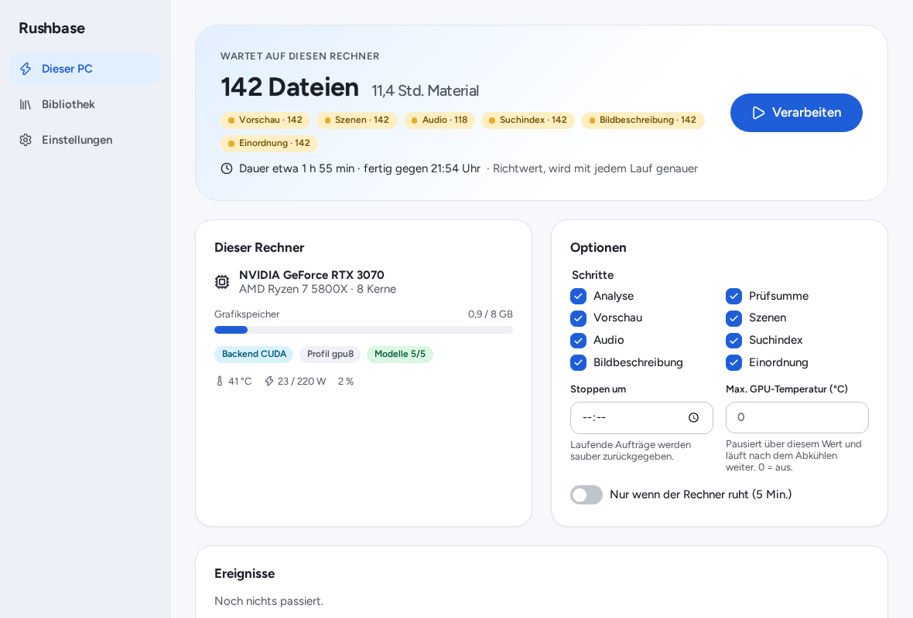
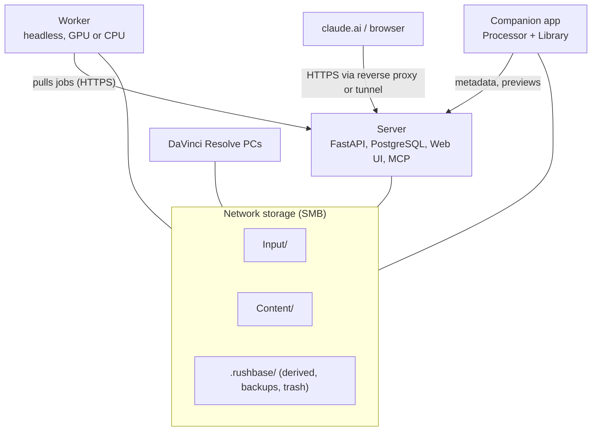

<p align="center">
  <picture>
    <source media="(prefers-color-scheme: dark)" srcset="docs/assets/logo-dark.svg">
    
  </picture>
</p>

<p align="center"><b>A self-hosted, AI-assisted media library for video, photo and audio on your network storage.</b></p>

<p align="center">
  <a href="https://github.com/Elias02345/RushBase/actions/workflows/ci.yml"></a>
  <a href="LICENSE"></a>
  <a href="https://github.com/Elias02345/RushBase/releases"></a>
  
  
</p>

Your team drops raw footage ("rushes") into an `Input/` folder on a NAS. Rushbase detects the
files, lets workers analyse them (technical metadata, camera settings, speech, image content,
categories), files them permanently into a structured `Content/` folder with sidecar metadata, and
makes everything searchable from a web UI, a desktop companion, a scriptable CLI and Claude via an
MCP connector. Originals are never modified, moved after filing, or streamed through the server.
Everything runs on your own hardware, with no telemetry.

<p align="center">
  <picture>
    <source media="(prefers-color-scheme: dark)" srcset="docs/screenshots/dashboard-dark.png">
    
  </picture>
  <picture>
    <source media="(prefers-color-scheme: dark)" srcset="docs/screenshots/library-dark.png">
    
  </picture>
  <picture>
    <source media="(prefers-color-scheme: dark)" srcset="docs/screenshots/asset-dark.png">
    
  </picture>
  <picture>
    <source media="(prefers-color-scheme: dark)" srcset="docs/screenshots/desktop-processor-idle-dark.png">
    
  </picture>
</p>

## Features

**Ingest and filing**
- Scans `Input/`, hashes and probes files, files new material into `Content/` by configurable rules
  (a rename on the same share, never a copy) and writes sidecars; paths are stable afterwards. See [filing](docs/filing.md).
- Quarantine and journal for odd files; the database is rebuildable from sidecars.

**AI analysis** (llama.cpp, whisper.cpp, ONNX Runtime; no PyTorch)
- Speech-to-text, audio events, image and video embeddings, vision-language descriptions with
  schema-validated output, shot detection, keyframes and a reviewable taxonomy. See [worker AI](docs/worker-ai.md).
- Runs on CPU, NVIDIA, AMD, Intel Arc and Apple Silicon. Workers pick up pending material as a batch
  and need no open port.

**Search**
- Hybrid full-text and semantic search, facets, filters, collections, bulk edit and a review list for
  AI results. Works fully with no worker online. See [search](docs/search.md).

**Editors and DaVinci Resolve**
- Desktop companion (Tauri) with a one-click processor and a library browser; send clips or scenes
  to DaVinci Resolve, export files, "used in project" feedback. See [companion](docs/companion.md).

**Claude and MCP**
- Built-in MCP server with its own OAuth 2.1 authorization server: search, gap analysis, needs lists
  ("what is still missing"), annotations and taxonomy proposals. No tool deletes or moves files.
  See [Connect to claude.ai](docs/mcp.md).

**Operations**
- Bare-metal or Docker installer, updater with rollback and release trains, watchdog, `doctor`,
  backups, disaster-recovery drill, reverse proxy and tunnel examples. See [operations](docs/operations.md).

## Architecture



Server, workers and apps each mount the share themselves; only metadata, jobs and derived previews
travel over HTTP. Architecture invariants are listed in [`CLAUDE.md`](CLAUDE.md); decisions in
[`docs/adr/`](docs/adr/README.md).

## Install

Download from [GitHub Releases](https://github.com/Elias02345/RushBase/releases) (checksums in
`SHA256SUMS`; the apps are not code-signed yet):

| OS | Download | First start |
| --- | --- | --- |
| Windows | `.msi` or `-setup.exe` | SmartScreen: *More info, Run anyway* |
| macOS (Apple Silicon) | `.dmg` | right-click the app, *Open* (or `xattr -dr com.apple.quarantine /Applications/Rushbase.app`) |
| Arch / CachyOS / Manjaro | `sudo pacman -U rushbase-bin-<version>-1-x86_64.pkg.tar.zst` | appears in the application launcher |
| Debian / Ubuntu, Fedora | `.deb` / `.rpm` | appears in the application launcher |
| Any Linux | `.AppImage` | `chmod +x`, run; use AppImageLauncher or Gear Lever for a menu entry |
| Headless worker (no GUI) | `rushbase-<version>-<os>-<arch>` | `rushbase enroll`, `rushbase process` |

Docker: `ghcr.io/elias02345/rushbase-server:<version>` and
`ghcr.io/elias02345/rushbase-worker:<version>-cpu|cuda|vulkan|rocm`. Server installer: see below.
Releasing: [docs/releasing.md](docs/releasing.md).

## Quick start

**1. Server** (Ubuntu/Debian, as root; all flags in [operations](docs/operations.md)):

```sh
git clone https://github.com/Elias02345/RushBase.git
cd RushBase
sudo bash install.sh                                                          # interactive
sudo bash install.sh --mode bare --yes --library /mnt/rushbase                # unattended, bare metal
sudo bash install.sh --mode docker --network host --yes --library /srv/media  # Docker, cgNAT / tunnel
```

The installer generates all secrets, sets up PostgreSQL, systemd units and a health check, and
prints the web UI address. Check an install later with `sudo bash doctor.sh`.

**2. Worker.** On the PC that does the analysis, mount the share and enrol it with the command shown
in the web UI under *Processing, Add a PC*:

```sh
rushbase enroll --server https://rushbase.example.org --token <one-time token> --name studio-pc
rushbase doctor
rushbase process --exit-when-empty
```

The desktop companion wraps the same steps ([companion guide](docs/companion.md)).

**3. Connect Claude.** Set `RUSHBASE_PUBLIC_URL`, then add `https://<host>/mcp` under *Settings,
Connectors, Add custom connector* in claude.ai. Step by step: [docs/mcp.md](docs/mcp.md).

## Documentation

- User guide: [English](docs/user-guide/en.md) | [Deutsch](docs/user-guide/de.md)
- [Operations and disaster recovery](docs/operations.md), [update rules](docs/UPDATE_RULES.md)
- [MCP / Claude](docs/mcp.md), [companion app](docs/companion.md), [worker](docs/worker.md), [CLI JSON contract](docs/cli-json.md)
- [Architecture decision records](docs/adr/README.md), [data model](docs/architecture/data-model.md)

## Status

Pre-1.0, feature-complete. Milestones M0 to M7 are implemented; v1.0 waits for signed releases, a
real claude.ai connector test and the manual test matrix on Windows/macOS. See [`docs/STATUS.md`](docs/STATUS.md) for details and
[`docs/release-checklist.md`](docs/release-checklist.md) for what is left before v1.0.
Configuration reference: [`.env.example`](.env.example).

## Development

Everything installs into a project-local toolchain; nothing is installed system-wide.

```sh
make setup                 # uv sync + pnpm install
make lint typecheck test   # ruff, eslint, prettier, mypy --strict, tsc, pytest, vitest
make testmedia             # synthetic media into dev/library/Input
make dev                   # PostgreSQL :15432, Samba :14450, server :18080, web :15173
make dev-down              # stops only the rushbase-dev compose project
```

Requirements: Docker, `make`, `curl`, Node.js and `ffmpeg`. See [`CONTRIBUTING.md`](CONTRIBUTING.md).

## Contributing, security, license

Contributions are welcome: please read [`CONTRIBUTING.md`](CONTRIBUTING.md) and the
[Code of Conduct](CODE_OF_CONDUCT.md). Report vulnerabilities privately, see [`SECURITY.md`](SECURITY.md).
Licensed under the [Apache License 2.0](LICENSE); third-party components in [`THIRD_PARTY.md`](THIRD_PARTY.md).
