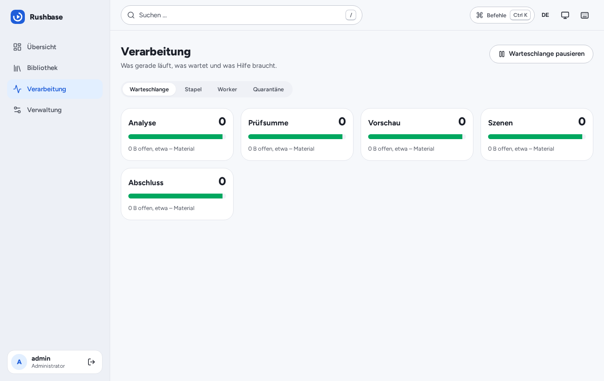
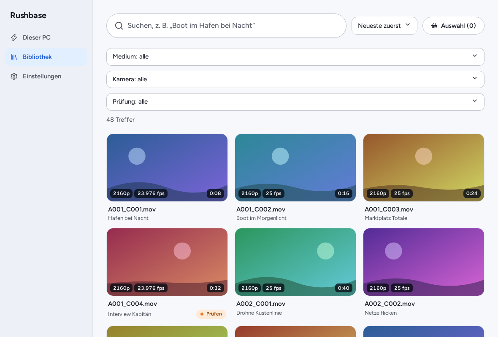

# Rushbase - Guide for editors and producers

[Deutsche Version](de.md)

Rushbase is your team's media library: raw footage (video, photo, audio) sits on the network
storage, Rushbase detects it, has a computer analyse it and makes it searchable. This guide is for
everyone who **finds, reviews and reuses** material - not for the people who install Rushbase (that
is in [operations.md](../operations.md)). The screenshots show the German interface; the web UI
and the app also run in English (language switch in the header).

## The short version

- Copy new material into the `Input/` folder on the storage. That is all you have to do.
- Rushbase **never changes your originals**. It reads and analyses them and only moves them into the
  library (`Content/`). Once filed, a file stays in its place forever, so edit projects do not break.
- **Search always works**, even when the analysis PC is off. New descriptions, transcripts and
  scenes need the analysis PC (the worker) to run.
- **Your corrections always win** over the AI.

## 1. Getting material in

1. On the storage, create one folder per shoot below `Input/`, named
   **`YYYY-MM-DD_Label`**, for example `2026-10-12_Imagefilm_Location-A`.
2. Copy the files (or whole camera card structures) into it.

What the folder name means:

| Part                   | Effect                                                                                  |
| ---------------------- | --------------------------------------------------------------------------------------- |
| `2026-10-12`           | Shoot date, used as a hint when the camera does not record a capture date.              |
| `Imagefilm_Location-A` | Label of the **batch**. It is searchable and ends up in the folder name in the library. |

Files placed directly in `Input/` are grouped into an automatic batch per day ("Auto 2026-10-12").
A folder per shoot is better.

Copy a camera card (for example `PRIVATE/M4ROOT/...`) **as a whole**; Rushbase treats it as one unit
and only files it once everything in it has been analysed.

### What happens next

The **Dashboard** and **Processing** show the way: _Input -> Analysis -> Library_.

| State      | Meaning                                                                                         |
| ---------- | ----------------------------------------------------------------------------------------------- |
| Copying    | The files are still being copied to the storage. Rushbase waits until nothing changes any more. |
| Waiting    | Detected, waiting for a worker.                                                                 |
| Processing | Being analysed right now.                                                                       |
| Review     | The analysis was unsure; a person should have a look (section 4).                               |
| Filed      | Done and placed in `Content/`.                                                                  |
| Quarantine | The file could not be processed (see FAQ).                                                      |

**The analysis PC has to be running.** The heavy work (scenes, image descriptions, spoken text) is
done by a worker, typically a PC with a graphics card that is only switched on when needed. While it
is off, material waits in the queue (the dashboard says "No worker online"). Once it is on, it works
through everything in one go. Whatever has been analysed already stays searchable.

## 2. Searching and filtering

In **Library** just type what you are looking for, in plain words, German or English:
_"drone over the harbour at sunset"_, _"interview woman with glasses"_, _"A001"_. Rushbase combines
full text (title, file name, camera, transcript, description) with image and meaning search.

- **Assets or scenes:** "Result type" switches between whole clips (**Material**) and single shots
  with a time position (**Szenen** / scenes). Scenes are ideal when you need exactly those ten
  seconds and not the whole clip.
- **Filters:** narrow down by media type, camera, lens, place, time of day, shot size, date,
  duration, tags and more. The numbers show how many results each value would give. "Reset" clears
  everything.
- **Sort and view:** relevance, newest, oldest, longest ...; grid or list.
- **Find similar:** in the asset detail (tab _Similar_) and for single scenes you find footage that
  looks like this - handy for alternatives to a shot.
- If a notice says semantic search is not active, only full-text hits are shown. That is not an error;
  search gets better as soon as the models are ready.

**Ctrl+K** (Mac: Cmd+K) opens the command palette, `?` lists all keyboard shortcuts.

## 3. Looking at an asset

A click opens the detail page.

- **Player:** you watch a preview (proxy). The original is never streamed through the server.
- **Shots:** below the player the detected shots are listed with key frames. A click jumps there.
- **Tabs:** _Technical_ (codec, resolution, camera ...), _Files_, _History_, _Transcript_
  (searchable, a click on a passage jumps to that point), _Tags_, _Description_ (AI text in German
  and English), _Privacy_ (see section 9), _Audio sync_ (only when a suggestion exists) and
  _Similar_.
- **Tags and their source:** every tag shows where it comes from: **AI** (detected automatically),
  **Claude** (set by Claude) or **By hand** (set by a person). By hand beats Claude, Claude beats AI.
- **Copy path:** "Copy path" gives you the file path for **your operating system** (Windows drive
  letter, macOS or Linux mount) to paste into your edit suite. "Copy relative path" gives the path
  from the library root.

## 4. Reviewing and correcting AI results

The AI is sometimes wrong. **Review** lists everything it was unsure about, with the reason ("unsure
about time of day", "image analysis and image search disagree", "no tags").

- **Approve** (key `A`): you looked at it, it is fine.
- **Correct:** opens the asset. Change title, rating, description, shot size, time of day ... or add
  tags and remove wrong ones.
- **Lock** (key `L`): locked material is **never** changed by the analysis again. Use it for
  everything you have finished curating.
- `J`/`K` or the arrow keys move to the next entry.

Good to know:

- What you set **by hand** is never overwritten by a new analysis.
- A tag you remove is not set again by the AI.
- Your edits stay even on unlocked material; locking additionally protects against _all_ automatic
  changes.

### Taxonomy: approving new terms

Tags come from a fixed vocabulary (field -> values, for example _Location -> Harbour_). When the AI
discovers a new term it only **proposes** it. Under **Taxonomy -> Proposals** you see how often it
came up and on which examples. You can

- **approve** it (it is used for search and filters from then on),
- **merge** it into an existing value (for example _harbour basin_ -> _harbour_), or
- ignore it.

Editors may approve; creating, renaming and merging fields and values is for administrators only.
Changes to the vocabulary restart the tagging of the affected material.

## 5. Needs lists: what is still missing

A **needs list** is a shopping list for pictures: "For the image film we still need a wide shot of
the harbour at night, two close-ups of hands ...". Each item has a description, optional filters and
a wanted count.

- Under **Needs** you create a list and write the shots you are looking for, one per line.
- When new material is filed, Rushbase **attaches matching hits automatically as candidates**. Nobody
  is notified; you see them when you open the list.
- Per candidate: **Confirm** or **Reject**. Once the wanted count is confirmed the item counts as
  fulfilled ("2 of 3 confirmed"). Rejected material is not suggested again for that item.
- When the project is done, **close** the list (you can reopen it at any time).

You can also have Claude create needs lists (section 8).

## 6. Collections and bulk edit

In the library, select several results (checkbox on the tile; "All loaded" selects everything
visible). The action bar appears:

- **Add to collection** - puts the selection into a collection, for example one per project.
  Collections are also a filter in the library.
- **Add or remove tags** for all selected items at once.
- **Lock** the whole selection.

Collections move nothing on the storage; they are just a view onto the same material.

## 7. The companion app

The desktop app "Rushbase Companion" runs on your computer and has two main areas.

**Processor: one click to process.** If your PC should do the heavy analysis (for example the one
with the graphics card), open the app. It shows how many files and hours of material are waiting and
roughly how long it takes. One click on **Process** ("Verarbeiten") starts the analysis; you see
progress, remaining time and a log. **Pause/Stop** hands unfinished work back to the queue cleanly.
Optional: only work until a given time, only while the PC is idle, or pause when the graphics card
gets too hot.

**Library:** the same search and filters as in the browser, but with previews read straight from the
storage and - if your system can play the format - the original in the player. You put clips or single
scenes into the **selection** and then

- **send them to DaVinci Resolve**,
- **export them as a file**, or
- copy the path or show it in the file manager.

### Resolve Studio or the free version?

|                   | Resolve Studio (21.1+)                                                                                                                                    | Resolve free                                                                                    |
| ----------------- | --------------------------------------------------------------------------------------------------------------------------------------------------------- | ----------------------------------------------------------------------------------------------- |
| "Send to Resolve" | **Yes:** creates bins, imports the clips into the open project, sets description, keywords and markers at the shots. Sending again creates no duplicates. | No (the free version cannot be scripted).                                                       |
| Export            | Possible as well.                                                                                                                                         | **FCPXML** (shots as clips on one timeline), **EDL**, **metadata CSV** for import into Resolve. |

Prerequisite for Studio: in Resolve under _Preferences -> System -> General_ set "External scripting
using" to "Local". Save your project before sending for the first time.

**Tip for mixed teams:** Resolve stores absolute paths. Use the same mount path on every machine (or
Resolve's "Mapped Mount") so projects work across Windows, macOS and Linux.

## 8. Using Rushbase with Claude

Once your administrator has set up the **Claude connector**, you can work with your library in plain
language in claude.ai. One time only: in claude.ai under _Settings -> Connectors -> Add custom
connector_ enter the Rushbase address (`https://<your-host>/mcp`), then sign in on the Rushbase page
with your normal account and click **Allow**.

Claude can search, look at details and key frames, find gaps in the stock, maintain needs lists and
suggest tags. Claude can **never delete or move** anything, and it does not act on its own - it only
answers when you ask. Every call is listed in the log in the administration.

Examples (in German, as your team would type them):

- _"Welche Drohnenaufnahmen von Standort A haben wir aus diesem Jahr?"_ (Which drone shots of
  location A do we have from this year?)
- _"Erstelle eine Bedarfsliste für ein 60-Sekunden-Imagevideo und prüfe, was fehlt."_ (Create a
  needs list for a 60-second image video and check what is missing.)
- _"Zeig mir ruhige Nahaufnahmen von Händen bei der Arbeit, nicht älter als sechs Monate."_ (Show me
  calm close-ups of hands at work, not older than six months.)
- _"Gibt es zu 'Hafen bei Nacht' Alternativen zu diesem Clip?"_ (Are there alternatives to this clip
  for "harbour at night"?)
- _"Markiere alle Interviews vom Dreh am 12. Oktober als 'Zu prüfen'."_ (Mark all interviews from the
  12 October shoot as "to review".)

Tags set by Claude carry the source **Claude**. Your own corrections take precedence.

## 9. Privacy: identifiable people and consent

For each asset (and each scene) Rushbase records whether a **person is identifiable** (yes / no /
unknown) and whether **consent** exists (yes / no / unknown, optionally with a reference to the
document).

- The AI estimates "person identifiable" as a hint; **a person decides**. You see the value in the
  _Description_ tab and can correct it.
- You enter the **consent** (or have Claude enter it: _"Setze die Einwilligung für alle Clips vom
  Interview am 12. Oktober auf Ja, Verweis 'Vertrag 2026-14'"_).
- In the library you can then filter, for example "person identifiable = yes and consent = unknown",
  to see what still has to be cleared before publication.
- **Finding a person's footage:** search for their name if it appears in the transcript or a tag, or
  for a description ("woman with a red scarf") and then filter on "person identifiable". This is a
  search, not face matching: Rushbase does not identify people by their face.
- **Locking protects your entries:** on locked material the analysis changes neither the person
  field nor the consent.
- **Editing in bulk:** in the library, select several assets and press _Privacy_ to set person
  identifiable, consent and the proof reference for all of them. In the _Privacy_ tab of one
  asset you edit the same fields, plus the lock.
- **Locking a whole batch or a person:** open _Privacy_ in the navigation. Choose a batch, or type
  a person's name. For a name, Rushbase finds the assets tagged with an approved value of the
  taxonomy field `person` (value, label or synonym) and the assets that mention the name in title,
  description or transcript. You see the number of matches first, then lock them all and optionally
  set the consent and its reference in the same step. Face recognition is off by default and is
  not implemented: this is a text lookup, so check the matches.

### Deleting: the trash

- **Deleting** is only possible for administrators in the web interface (never through Claude or
  the companion app). Open an asset and press _Move to trash_ (for a duplicate: _Move duplicate to
  trash_), then confirm the dialog.
- The files (the whole card folder for camera cards, plus the sidecars) are **moved**, not copied,
  to `.rushbase/trash/<asset id>/` with their folder structure. Nothing is deleted yet. Duplicates
  are moved out of `Input/`.
- _Administration -> Trash_ lists everything with the date it will be deleted for good (default
  30 days; you set the retention period there). _Restore_ moves the files back; if something else
  now occupies the original path Rushbase tells you which and moves nothing.
- Expired items are deleted permanently by the server's maintenance job. That is the only place in
  Rushbase that ever deletes media, and every deletion is recorded in the audit log.

### Audio that belongs to a video

When a sound recorder's file (BWF/iXML timecode) and a video of the same batch overlap in time,
the asset page gets an _Audio sync_ tab with a **suggestion**: offset, confidence and the basis
(timecode or capture time). Nothing is linked until you press _Confirm_; _Reject_ hides it.
Confirmed pairs are written to both sidecars.

### Re-filing existing material (optional)

_Administration -> Migration_ is off by default. When switched on, you pick a batch and a new
filing rule, see a preview of every move and run it by typing the confirmation text shown. Files
are moved by rename, journalled, their sidecars follow, and you download a **relink list** (CSV with
old and new path per operating system) to reconnect the clips in DaVinci Resolve. Claude cannot
start a migration.

## 10. FAQ and troubleshooting

**My file is still in `Input/` and does not show up in the library.**
That is normal until it has been analysed. Check _Processing -> Queue_: "Waiting" means no worker is
running - start the analysis PC or press **Process** in the companion app. If it was just being
copied, Rushbase waits a few minutes until the file stops changing. Camera cards are only filed once
the whole card is done.

**Where is my material after filing?**
Under `Content/` in the path `media type/year/date_label/`, for example
`Content/video/2026/2026-10-12_Imagefilm_Location-A/`. The exact path is shown in the detail via
"Copy path". Rushbase never changes file names.

**What does "Quarantine" mean?**
The file could not be read or processed (for example copied incompletely, or damaged). It stays
untouched in `Input/`. Under _Processing -> Quarantine_ you can start it again with **Retry** after
copying the file anew. If that does not help, open the file in a player.

**What is a "Duplicate"?**
Rushbase already has the same file (same content) in the library. The duplicate is **not** filed and
**not** deleted; it stays in `Input/`, and the dashboard shows how much space duplicates use. An
administrator, or you by hand, can clean up.

**I cannot find something that should be there.**
First check whether filters are active ("Reset"). Then whether the material is filed yet (dashboard).
Also search for the file name. If the analysis PC has not seen the material yet there is no
description or transcript - but file name and batch label are searchable immediately.

**The AI tagged something wrong.**
Remove or replace the tag; the change is by hand and stays. For finished material also **lock** it.

**May I rename or move files in the library?**
Please do not. Rushbase relies on filed files staying where they are. Organise with tags,
collections and filters instead.

**Whom do I ask when something is wrong?**
Your administrator. They find users, workers, backups and the log under _Administration_ (see
[operations.md](../operations.md)).
